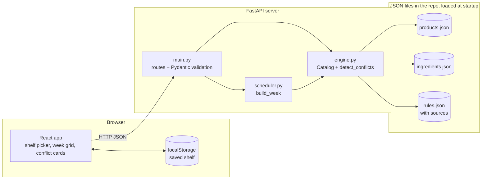
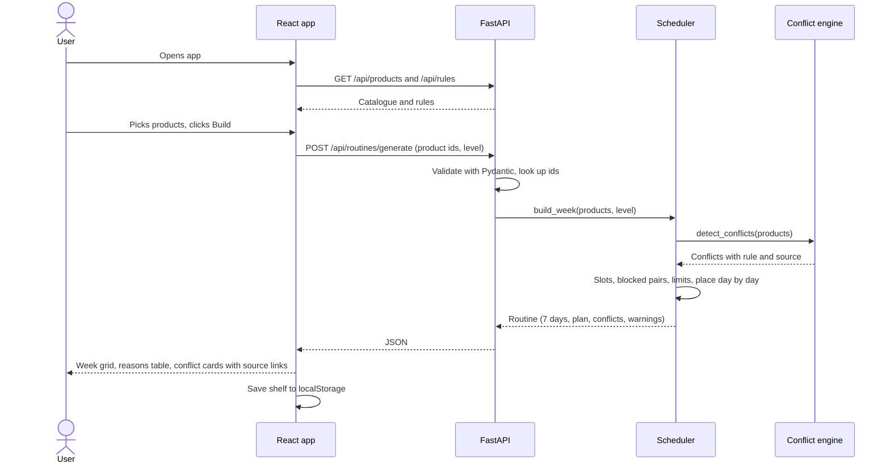

# SkinSync — v1 Architecture

_Last updated: 16 Nov 2026. Matches the code in `backend/` and `frontend/` as built in Phase 2, step 1._

**v1 in one line:** pick products from a small Indian-market catalogue, get the conflicts between them and a 7-day AM/PM routine that avoids those conflicts.

---

## 1. Stack

| Layer | Choice | Why (in one line) | What we give up |
|---|---|---|---|
| Frontend | React 18 + Vite | You already know React. Vite starts fast and needs no config. | No server-side rendering. Not needed for a tool like this. |
| Styling | One plain CSS file | The UI is one page with four sections. | No design system. |
| Backend | FastAPI (Python) | Pydantic checks request and data shapes for free. Auto-generated API docs at `/docs`. | A second thing to deploy, compared with doing all logic in the browser. |
| Data validation | Pydantic models (`models.py`) | A typo in a data file fails at startup, not in front of a user. | A little boilerplate. |
| Storage | **JSON files in the repo**, loaded into memory at startup | Data is small, read-only and hand-curated. Git history shows every rule change. | No user accounts, no saved routines on the server, no writes. |
| User state | Browser `localStorage` for the shelf | Keeps the shelf between visits with zero backend work. | Shelf does not follow the user to another device. |
| Tests | pytest (18 tests) on the engine, scheduler and API | The core is pure functions: data in, data out. | No frontend tests in v1. |
| Deploy | Not deployed yet. Plan: Vercel (frontend) + Render free tier (backend) | Free, and a live link on a resume beats a GitHub link. | Render's free tier sleeps when idle. |

**Why not a database in v1?** There is nothing to write. Three small read-only files do not need SQL. A database goes in when accounts and saved routines arrive.

**Why keep a backend at all, if the data is static?** The engine is easier to unit-test in Python, the AI features need a server to hold the API key, and it shows full-stack work. The honest cost is one more deploy.

---

## 2. Data model

### Product (`data/products.json`, 30 products)

```
Product
  id            "minimalist-retinol-03-serum"
  name, brand
  brand_origin  "IN", "CA", "GB", "FR", "KR"
  type          cleanser | toner | serum | treatment | moisturizer | sunscreen
  price_inr     MRP shown on the source page on 16 Nov 2026
  actives       ingredient ids, e.g. ["retinol"]   (headline actives only)
  source_url    the page the name, price and actives came from
  note          optional caveat
```

25 products are from Indian brands (Minimalist, Deconstruct, The Derma Co, Dot & Key). 5 are foreign brands sold in India (The Ordinary, Simple, Garnier, Tonymoly).

### Ingredient (`data/ingredients.json`, 19 ingredients)

```
Ingredient
  id, name, aliases
  family    retinoid | aha | bha | vitamin_c | benzoyl_peroxide | niacinamide | none
```

Rules are written against **families**, so adding lactic acid to the AHA family needs no new rule.

### Rules (`data/rules.json`)

```
ConflictRule                              TimingRule
  id                "R1"                    id                    "T1"
  family_a, family_b                        family
  type        irritation|deactivation|myth  allowed_slots         ["PM"]
  severity    high | medium | info          max_days_per_week     {beginner: 3, regular: 7}
  resolution  separate_days |               no_consecutive_days   {beginner: true, regular: false}
              separate_slots | none         needs_sunscreen       true
  skip_if_wash_off  relax for a face wash   explanation, source_title, source_url
  explanation, source_title, source_url
```

7 conflict rules (R1 to R7) and 4 timing rules (T1 to T4). The rules and their sources are listed in `PHASE1_RESEARCH.md`.

### Routine (API output, not stored)

```
Routine
  level       beginner | regular
  days        7 x { day, am: Step[], pm: Step[] }
  plan        one line per product: slots, days, reasons
  conflicts   each with rule, source and "resolved_how"
  warnings    e.g. "retinoid on shelf but no sunscreen"
```

---

## 3. Core algorithm

Two functions. Both are pure: same input, same output, no database.

### 3.1 `detect_conflicts` (`backend/app/engine.py`)

```
for each pair (p1, p2) of products on the shelf:
    for each family f1 in p1, f2 in p2:
        rule = rule for the pair {f1, f2}          # order does not matter
        if no rule: continue
        if rule.skip_if_wash_off and one product is a cleanser:
            record it as "info" (face wash, lower risk)
        else:
            record the conflict with the rule's severity and source
```

n products means n*(n-1)/2 pairs. A shelf of 10 is 45 pairs, so speed is not a concern.

### 3.2 `build_week` (`backend/app/scheduler.py`)

Two kinds of product:

- **Active:** a leave-on product with a "strong" family (retinoid, AHA, BHA, vitamin C, benzoyl peroxide). These need careful placing.
- **Basic:** everything else, including all cleansers. These go on every day.

```
1. AM or PM for each active
     start from the product type's normal slots (sunscreen = AM)
     narrow by timing rules (retinoid, AHA = PM only; vitamin C = AM only)
     if still free to choose: pick the slot with fewer clashing products in it

2. Decide which pairs of actives must not share a DAY
     - two clashing actives that ended up in the same slot
     - any "separate_days" rule, even across AM and PM
   Other clashes are already solved by being in different slots.

3. Weekly limit for each active (from timing rules and the user's level)
     e.g. beginner retinoid: at most 3 nights, never two nights running

4. Place actives day by day, Monday to Sunday (greedy)
     each day, go through the actives, fewest-days-so-far first
     skip an active if:  it hit its weekly limit
                         it was used yesterday and must not repeat
                         it clashes with an active already placed today

5. Basics go on every day in their normal slots
     exception: a face wash that truly clashes with an active
     (benzoyl peroxide wash + retinol) is removed from that active's slot

6. Sort each routine into layering order:
     cleanser, toner, serum, treatment, moisturizer, sunscreen

7. Warnings: retinoid or AHA on the shelf but no sunscreen;
             an active that could not get enough days; a product left out
```

**Worked example** (beginner): gentle cleanser, vitamin C serum, retinol serum, glycolic toner, niacinamide serum, moisturizer, sunscreen.

- Conflicts: retinol + glycolic (R1, different days), vitamin C + retinol (R5), vitamin C + glycolic (R6), niacinamide + vitamin C (R7, myth).
- Slots: retinol PM, glycolic PM, vitamin C AM. That alone settles R5 and R6.
- Day by day: Mon retinol, Tue glycolic, Wed retinol, Thu glycolic, Fri retinol. Sat and Sun are rest nights.
- Every morning: cleanser, niacinamide, vitamin C, moisturizer, sunscreen.

**Why this is a graph problem.** Picture each active as a dot, with a line between two that must not share a day. Each day we pick a set of dots with no line between them. Finding the best possible weekly plan is a hard problem in general (it is related to graph colouring, which is NP-hard), but a shelf has about five actives, so a simple greedy pass is fast and easy to explain.

**Known limits**

- Greedy is not guaranteed to find the best plan. With under 10 products it gives sensible plans in every case tested.
- Fixed week starting Monday. No "every 3rd day" patterns.
- Only headline actives are read, with no concentrations.
- A face wash that clashes with actives in both AM and PM is dropped with a warning, which is cautious.

---

## 4. Architecture diagram



## 5. Data-flow diagram (generate a routine)



---

## 6. API endpoints

All under `/api`. The server keeps no user state. Interactive docs at `/docs`.

| Method | Path | Purpose | Request | Response |
|---|---|---|---|---|
| GET | `/health` | Is the server up | none | `{status, products}` |
| GET | `/products` | Catalogue. Optional `q`, `brand`, `type` filters. | query params | `Product[]` |
| GET | `/products/{id}` | One product plus its families | none | `Product + families` |
| GET | `/ingredients` | Ingredient list with families | none | `Ingredient[]` |
| GET | `/rules` | All conflict and timing rules with sources | none | `{conflicts, timing}` |
| POST | `/conflicts/check` | Conflicts only, no schedule | `{product_ids}` | `Conflict[]` |
| POST | `/routines/generate` | The main call | `{product_ids, level}` | `Routine` |

Errors: unknown product id returns 404 naming the bad id. Empty list or more than 15 products returns 422.

---

## 7. Folder structure

```
skinsync/
  data/            products.json, ingredients.json, rules.json
  backend/
    app/
      main.py      FastAPI app and routes
      models.py    Pydantic models
      engine.py    Catalog (loads data) + detect_conflicts
      scheduler.py build_week
    tests/         test_engine.py (18 tests)
    requirements.txt
  frontend/
    src/           App.jsx, api.js, styles.css, main.jsx
  docs/            PHASE1_RESEARCH.md, ARCHITECTURE.md
  INTERVIEW_NOTES.md
  README.md
```

---

## 8. Not in v1

Login, database, saved routines on the server, deployment, AI features (A1 explain, A2 label scan, planned next; A3 Q&A is "later"), product recommendations, skin-type personalisation, mobile app.

## 9. Changes from the Phase 1 design

- The scheduler places actives **day by day** instead of first grouping them into "night groups". Same idea (a conflict graph and a greedy pass), but it also handles clashes across AM and PM and is easier to follow.
- Added timing rules T3 (leave-on BHA limit) and T4 (vitamin C in the morning), and a weekly limit for AHAs, after finding sources.
- Added `GET /api/ingredients`.
- `price` became `price_inr`; products gained `id`, `brand_origin`, `source_url`.
